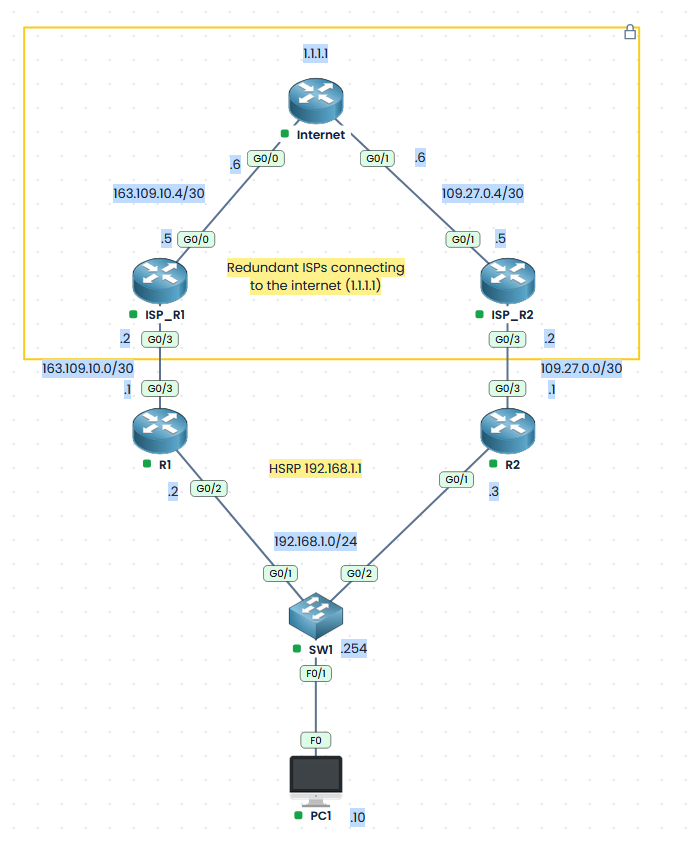

# CCNA Lab – HSRP (Hot Standby Router Protocol)

## Lab overview

This lab uses the [PingMyNetwork Sandbox](https://www.pingmynetwork.com) to practise configuring, verifying, and troubleshooting **HSRP (Hot Standby Router Protocol)**, a first-hop redundancy protocol that provides a failover default gateway for LAN devices.

Two routers, **R1** and **R2**, connect to the same LAN through **SW1**. Each router also has its own connection to an ISP router, **ISP_R1** and **ISP_R2**, simulating ISP redundancy. Both LAN-facing interfaces on each router participate in HSRP and share the virtual IP address **192.168.1.1**, which PC1 will use as its default gateway. The Internet router is a simulated internet, with connectivity to 1.1.1.1 simulating a working internet.

R1 is the preferred **active** gateway; R2 is the **standby**. Interface tracking reduces a router's HSRP priority if its ISP-facing link goes down, allowing the router with a working connection to become active.

## Lab Objectives

- Configure HSRP **version 2** on R1 and R2.
- Configure HSRP **group 1** with virtual IP address `192.168.1.1`.
- Make R1 the preferred active router and R2 the standby router using HSRP priorities.
- Configure **preemption** so the higher-priority router can take over.
- Configure **interface tracking** on each router's ISP-facing link.
- Verify the active/standby roles and test failover and recovery.



## Addressing and HSRP roles

| Device | Interface | IP address | Purpose |
|---|---|---|---|
| R1 | G0/2 | `192.168.1.2/24` | LAN; preferred HSRP active router |
| R2 | G0/1 | `192.168.1.3/24` | LAN; preferred HSRP standby router |
| HSRP group 1 | Virtual | `192.168.1.1` | Default gateway shared by R1 and R2 |
| R1 | G0/3 | `163.109.10.1/30` | ISP-facing interface to track |
| R2 | G0/3 | `109.27.0.1/30` | ISP-facing interface to track |
| PC1 | NIC | `192.168.1.10/24` | LAN host; gateway `192.168.1.1` |

**Prerequisites:** Both LAN interfaces must be enabled, use their own unique addresses, and be in the same VLAN/broadcast domain through SW1. PC1 must use the **virtual IP** as its gateway, not R1's or R2's physical IP.

---

## Task 1 – Configure HSRP version 2 on R1

R1 is the preferred active gateway, it should be given a priority of **110** (above the default priority of 100). Enable **preempt** so it can reclaim the active role after recovering from a failure.

```cisco
R1# conf t
R1(config)# interface GigabitEthernet0/2
R1(config-if)# standby version 2
R1(config-if)# standby 1 ip 192.168.1.1
R1(config-if)# standby 1 priority 110
R1(config-if)# standby 1 preempt
R1(config-if)# end
```

Verify in 'show run'

```
interface GigabitEthernet0/2
 ip address 192.168.1.2 255.255.255.0
 standby version 2
 standby 1 ip 192.168.1.1
 standby 1 priority 110
 standby 1 preempt
 duplex auto
 speed auto
 media-type rj45
```


| Command | Purpose |
|---|---|
| `standby version 2` | Select HSRP version 2 on the interface. |
| `standby 1 ip 192.168.1.1` | Assign the shared virtual IP to HSRP group 1. |
| `standby 1 priority 110` | Make R1 the preferred active router. |
| `standby 1 preempt` | Allow R1 to take over when its priority exceeds the current active router's priority. |

## Task 2 – Configure HSRP version 2 on R2

R2 uses the same group and virtual IP but a lower priority of **100**. Enable preempt here too: R2 will need it to take over when tracking reduces R1's priority below 100 while R1 is still participating in HSRP.

```cisco
R2# conf t
R2(config)# interface GigabitEthernet0/1
R2(config-if)# standby version 2
R2(config-if)# standby 1 ip 192.168.1.1
R2(config-if)# standby 1 priority 100
R2(config-if)# standby 1 preempt
R2(config-if)# end
```

Verify in 'show run'

```
interface GigabitEthernet0/1
 ip address 192.168.1.3 255.255.255.0
 standby version 2
 standby 1 ip 192.168.1.1
 standby 1 preempt
 duplex auto
 speed auto
 media-type rj45
```


With both routers and their tracked links operating normally:

| Router | HSRP group | Priority | Expected role |
|---|---:|---:|---|
| R1 | 1 | 110 | Active |
| R2 | 1 | 100 | Standby |

HSRP uses a **virtual IP and virtual MAC address**. PC1 keeps sending traffic to `192.168.1.1` even when the active physical router changes.

---

## Task 3 – Configure HSRP interface tracking

HSRP detects the failure of an active router, but a router can remain up and connected to SW1 even if its ISP-facing interface goes down. **Interface tracking** handles this case by lowering its HSRP priority.

### R1 – Track the ISP-facing interface

R1's LAN interface is `G0/2`; the ISP-facing interface being monitored is `G0/3`.

```cisco
R1#conf t
Enter configuration commands, one per line.  End with CNTL/Z.
R1(config)#track 1 interface gigabitEthernet 0/3 line-protocol 
R1(config-track)#int gi 0/2
R1(config-if)#standby 1 track 1 decrement 20
R1(config-if)#end
```

If R1's `G0/3` goes down, its priority decreases from **110 to 90**. R2 remains at **100**, so R2 can preempt and become active.

### R2 – Track the ISP-facing interface

```cisco
R2#conf t
Enter configuration commands, one per line.  End with CNTL/Z.
R2(config)#track 1 interface gigabitEthernet 0/3 line-protocol 
R2(config-track)#int gi 0/1
R2(config-if)#standby 1 track 1 decrement 20
R2(config-if)#end
```

If R2's `G0/3` goes down, its priority decreases from **100 to 80**.

| Router | Priority with WAN up | Tracking decrement | Priority with WAN down |
|---|---:|---:|---:|
| R1 | 110 | 20 | 90 |
| R2 | 100 | 20 | 80 |

> **Important:** This form of tracking monitors the **interface state**, not end-to-end Internet reachability. If an upstream device fails while `G0/3` remains up, the HSRP priority may not change.

---

## Task 4 – Verify HSRP operation

Run the following on **both R1 and R2**:

```cisco
show standby brief
show standby
```

```
R1#show standby brief 
                     P indicates configured to preempt.
                     |
Interface   Grp  Pri P State   Active          Standby         Virtual IP
Gi0/2       1    110 P Active  local           192.168.1.3     192.168.1.1
R1#show standby 
GigabitEthernet0/2 - Group 1 (version 2)
  State is Active
    4 state changes, last state change 00:07:31
  Virtual IP address is 192.168.1.1
  Active virtual MAC address is 0000.0c9f.f001
    Local virtual MAC address is 0000.0c9f.f001 (v2 default)
  Hello time 3 sec, hold time 10 sec
    Next hello sent in 1.883 secs
  Preemption enabled
  Active router is local
  Standby router is 192.168.1.3, priority 100 (expires in 8.883 sec)
  Priority 110 (configured 110)
    Track object 1 state Up decrement 20
  Group name is "hsrp-Gi0/2-1" (default)
R1#
```

```
R2#show standby brief 
                     P indicates configured to preempt.
                     |
Interface   Grp  Pri P State   Active          Standby         Virtual IP
Gi0/1       1    100 P Standby 192.168.1.2     local           192.168.1.1
R2#show standby 
GigabitEthernet0/1 - Group 1 (version 2)
  State is Standby
    4 state changes, last state change 00:07:55
  Virtual IP address is 192.168.1.1
  Active virtual MAC address is 0000.0c9f.f001
    Local virtual MAC address is 0000.0c9f.f001 (v2 default)
  Hello time 3 sec, hold time 10 sec
    Next hello sent in 0.597 secs
  Preemption enabled
  Active router is 192.168.1.2, priority 110 (expires in 7.649 sec)
  Standby router is local
  Priority 100 (configured 100)
    Track object 1 state Up decrement 20
  Group name is "hsrp-Gi0/1-1" (default)
R2#
```

`show standby brief` provides a quick view of the group, priority, current state, active router, standby router and virtual IP address.

`show standby` provides more detail, including preemption and tracked interfaces.

**Expected normal operation:**

- **R1:** HSRP group 1, priority **110**, state **Active**, VIP `192.168.1.1`.
- **R2:** HSRP group 1, priority **100**, state **Standby**, VIP `192.168.1.1`.

On PC1, verify the configured default gateway is `192.168.1.1`, then test:

```text
ping 192.168.1.1
ping 1.1.1.1
```

```
C:\>ping 1.1.1.1

Pinging 1.1.1.1 with 32 bytes of data:

Reply from 1.1.1.1: bytes=32 time=44ms TTL=253
Reply from 1.1.1.1: bytes=32 time=25ms TTL=253
Reply from 1.1.1.1: bytes=32 time=15ms TTL=253
Reply from 1.1.1.1: bytes=32 time=21ms TTL=253

Ping statistics for 1.1.1.1:
    Packets: Sent = 4, Received = 4, Lost = 0 (0% loss),
Approximate round trip times in milli-seconds:
    Minimum = 15ms, Maximum = 44ms, Average = 26ms
```

---

## Task 5 – Test R1 ISP interface failure

**Goal:** Confirm that interface tracking triggers an HSRP role change even though R1 remains connected to the LAN.

On R1, shut down the ISP-facing interface:

```cisco
R1# conf t
R1(config)# interface GigabitEthernet0/3
R1(config-if)# shutdown
R1(config-if)# end
```

Verify on both routers:

```cisco
show standby brief
show standby
```

```
R1#conf t
Enter configuration commands, one per line.  End with CNTL/Z.
R1(config)#int gi 0/3
R1(config-if)#shutdown 
R1(config-if)#end
*Oct 20 20:50:09.457: %SYS-5-CONFIG_I: Configured from console by console
*Oct 20 20:50:09.626: %TRACK-6-STATE: 1 interface Gi0/3 line-protocol Up -> Down
*Oct 20 20:50:10.794: %LINK-5-CHANGED: Interface GigabitEthernet0/3, changed state to administratively down
*Oct 20 20:50:11.794: %LINEPROTO-5-UPDOWN: Line protocol on Interface GigabitEthernet0/3, changed state to down
*Oct 20 20:50:12.193: %HSRP-5-STATECHANGE: GigabitEthernet0/2 Grp 1 state Active -> Speak
*Oct 20 20:50:22.193: %HSRP-5-STATECHANGE: GigabitEthernet0/2 Grp 1 state Speak -> Standby
R1#show standby brief 
                     P indicates configured to preempt.
                     |
Interface   Grp  Pri P State   Active          Standby         Virtual IP
Gi0/2       1    90  P Standby 192.168.1.3     local           192.168.1.1
R1#show standby 
GigabitEthernet0/2 - Group 1 (version 2)
  State is Standby
    6 state changes, last state change 00:00:10
  Virtual IP address is 192.168.1.1
  Active virtual MAC address is 0000.0c9f.f001
    Local virtual MAC address is 0000.0c9f.f001 (v2 default)
  Hello time 3 sec, hold time 10 sec
    Next hello sent in 0.873 secs
  Preemption enabled
  Active router is 192.168.1.3, priority 100 (expires in 7.925 sec)
  Standby router is local
  Priority 90 (configured 110)
    Track object 1 state Down decrement 20
  Group name is "hsrp-Gi0/2-1" (default)
R1#
```

```
*Oct 20 20:50:12.167: %HSRP-5-STATECHANGE: GigabitEthernet0/1 Grp 1 state Standby -> Active
R2#show standby brief 
                     P indicates configured to preempt.
                     |
Interface   Grp  Pri P State   Active          Standby         Virtual IP
Gi0/1       1    100 P Active  local           192.168.1.2     192.168.1.1
R2#show standby 
GigabitEthernet0/1 - Group 1 (version 2)
  State is Active
    5 state changes, last state change 00:00:51
  Virtual IP address is 192.168.1.1
  Active virtual MAC address is 0000.0c9f.f001
    Local virtual MAC address is 0000.0c9f.f001 (v2 default)
  Hello time 3 sec, hold time 10 sec
    Next hello sent in 2.957 secs
  Preemption enabled
  Active router is local
  Standby router is 192.168.1.2, priority 90 (expires in 9.957 sec)
  Priority 100 (configured 100)
    Track object 1 state Up decrement 20
  Group name is "hsrp-Gi0/1-1" (default)
```


**Expected results:**

1. R1's monitored WAN interface goes down.
2. R1's HSRP priority decreases from **110 to 90**.
3. R2, with priority **100** and preemption enabled, becomes **Active**.
4. R1 becomes **Standby**.
5. PC1 continues to use `192.168.1.1` as its default gateway.

| Router | Effective priority | Expected role |
|---|---:|---|
| R1 | 90 | Standby |
| R2 | 100 | Active |

Repeat the pings from PC1. A brief interruption is possible during failover. Internet ping success also depends on the pre-existing return route configuration; its behaviour is not guaranteed to follow an HSRP role change.

### Restore R1 and test preemption

```cisco
R1# conf t
R1(config)# interface GigabitEthernet0/3
R1(config-if)# no shutdown
R1(config-if)# end
```

**Expected results:** R1's priority returns to **110** and, because preemption is enabled, R1 becomes **Active** again. R2 returns to **Standby**.

```
R1#conf t
Enter configuration commands, one per line.  End with CNTL/Z.
R1(config)#int gi 0/3
R1(config-if)#no shut
R1(config-if)#end
*Oct 20 20:52:06.638: %SYS-5-CONFIG_I: Configured from console by console
*Oct 20 20:52:08.152: %LINK-3-UPDOWN: Interface GigabitEthernet0/3, changed state to up
*Oct 20 20:52:08.626: %TRACK-6-STATE: 1 interface Gi0/3 line-protocol Down -> Up
*Oct 20 20:52:09.152: %LINEPROTO-5-UPDOWN: Line protocol on Interface GigabitEthernet0/3, changed state to up
*Oct 20 20:52:09.203: %HSRP-5-STATECHANGE: GigabitEthernet0/2 Grp 1 state Standby -> Active
R1#show standby brief 
                     P indicates configured to preempt.
                     |
Interface   Grp  Pri P State   Active          Standby         Virtual IP
Gi0/2       1    110 P Active  local           192.168.1.3     192.168.1.1
R1#show standby 
GigabitEthernet0/2 - Group 1 (version 2)
  State is Active
    7 state changes, last state change 00:00:20
  Virtual IP address is 192.168.1.1
  Active virtual MAC address is 0000.0c9f.f001
    Local virtual MAC address is 0000.0c9f.f001 (v2 default)
  Hello time 3 sec, hold time 10 sec
    Next hello sent in 0.265 secs
  Preemption enabled
  Active router is local
  Standby router is 192.168.1.3, priority 100 (expires in 7.265 sec)
  Priority 110 (configured 110)
    Track object 1 state Up decrement 20
  Group name is "hsrp-Gi0/2-1" (default)
R1#
```

---

## Task 6 – Test R1 LAN Interface Failure

**Goal:** Check that R2 takes over even without a tracking priority change.

Shut down R1's LAN-facing interface:

```cisco
R1# conf t
R1(config)# interface GigabitEthernet0/2
R1(config-if)# shutdown
R1(config-if)# end
```

R1 can no longer participate in HSRP on the LAN. After the HSRP failure detection interval, R2 should become **Active**.

Check R2:

```cisco
R2# show standby brief
```

Restore R1's LAN interface:

```cisco
R1# conf t
R1(config)# interface GigabitEthernet0/2
R1(config-if)# no shutdown
R1(config-if)# end
```

```
R1#conf t
Enter configuration commands, one per line.  End with CNTL/Z.
R1(config)#int gi 0/2
R1(config-if)#shut
*Oct 20 20:53:07.793: %HSRP-5-STATECHANGE: GigabitEthernet0/2 Grp 1 state Active -> Init
*Oct 20 20:53:09.793: %LINK-5-CHANGED: Interface GigabitEthernet0/2, changed state to administratively down
*Oct 20 20:53:10.793: %LINEPROTO-5-UPDOWN: Line protocol on Interface GigabitEthernet0/2, changed state to down
R1(config-if)#end
```

```
*Oct 20 20:53:07.793: %HSRP-5-STATECHANGE: GigabitEthernet0/1 Grp 1 state Standby -> Active
R2#show standby brief 
                     P indicates configured to preempt.
                     |
Interface   Grp  Pri P State   Active          Standby         Virtual IP
Gi0/1       1    100 P Active  local           unknown         192.168.1.1
```

Once HSRP communication resumes, R1 should reclaim the active role because it has higher priority and preemption is enabled.

---

## Task 7 – Test R2 ISP interface failure

Shut down `G0/3` on R2:

```cisco
R2# conf t
R2(config)# interface GigabitEthernet0/3
R2(config-if)# shutdown
R2(config-if)# end
```

R2's priority should fall from **100 to 80**. If R1 is healthy at priority **110**, R1 remains **Active**.

```
R2#conf t
Enter configuration commands, one per line.  End with CNTL/Z.
R2(config)#int gi 0/3
R2(config-if)#shut
R2(config-if)#end
*Oct 20 20:56:07.165: %SYS-5-CONFIG_I: Configured from console by console
*Oct 20 20:56:07.198: %TRACK-6-STATE: 1 interface Gi0/3 line-protocol Up -> Down
*Oct 20 20:56:08.632: %LINK-5-CHANGED: Interface GigabitEthernet0/3, changed state to administratively down
*Oct 20 20:56:09.632: %LINEPROTO-5-UPDOWN: Line protocol on Interface GigabitEthernet0/3, changed state to down
R2#show standby brief 
                     P indicates configured to preempt.
                     |
Interface   Grp  Pri P State   Active          Standby         Virtual IP
Gi0/1       1    80  P Standby 192.168.1.2     local           192.168.1.1
R2#
```

Restore the interface when finished:

```cisco
R2# conf t
R2(config)# interface GigabitEthernet0/3
R2(config-if)# no shutdown
R2(config-if)# end
```

## Expected HSRP behaviour summary

| Scenario | R1 priority | R2 priority | Expected active router |
|---|---:|---:|---|
| Both WAN interfaces up | 110 | 100 | R1 |
| R1 WAN interface down | 90 | 100 | R2 |
| R1 WAN recovers | 110 | 100 | R1 (preempts) |
| R2 WAN interface down | 110 | 80 | R1 |
| Both WAN interfaces down | 90 | 80 | R1, although neither ISP link is usable |
| R1 LAN interface down | Not participating | 100 | R2 |


---

## CCNA concepts reinforced

| Concept | Description |
|---|---|
| HSRP | First-hop redundancy between routers sharing a LAN |
| Virtual IP | Stable default gateway address for hosts |
| HSRP version 2 | HSRP protocol version selected on both interfaces |
| Active router | Router responsible for forwarding traffic sent to the virtual gateway |
| Standby router | Backup router ready to take over |
| Priority | Controls which router is preferred as active |
| Preemption | Allows a router with a higher priority to take over |
| Interface tracking | Reduces HSRP priority if a monitored interface goes down |
| Failover | Change from one active gateway to another |

The CCNA blueprint focuses on describing the purpose and function of first-hop redundancy protocols; hands-on HSRP configuration and tracking provide useful additional practice.

## Lab checklist

- [ ] Confirm the LAN interfaces and PC1 addressing.
- [ ] Configure HSRP version 2 and group 1 on R1.
- [ ] Configure HSRP version 2 and group 1 on R2.
- [ ] Set the shared virtual IP to `192.168.1.1`.
- [ ] Set R1's priority to 110 and R2's priority to 100.
- [ ] Enable preemption on both routers.
- [ ] Track each router's ISP-facing `G0/3` interface with decrement 20.
- [ ] Verify R1 Active / R2 Standby with both WAN interfaces up.
- [ ] Shut down R1's WAN interface and verify R2 takes over.
- [ ] Restore R1's WAN interface and verify preemption.
- [ ] Shut down R1's LAN interface and verify R2 takes over.
- [ ] Test R2's WAN interface tracking.
- [ ] Record the observed results and any packet loss during convergence.

## Conclusion

HSRP version 2 allows R1 and R2 to provide a single virtual default gateway, **192.168.1.1**, for PC1. With priorities and preemption configured, R1 is normally active and R2 is standby. Interface tracking allows HSRP to move the active gateway to R2 when R1's ISP-facing interface fails, even if R1's LAN interface remains up.

The key lesson is that **HSRP provides default gateway redundancy**, while successful end-to-end connectivity also depends on the separately configured upstream and return paths.
