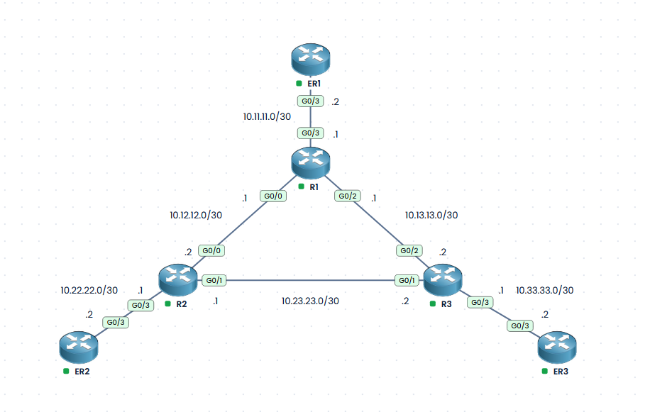

# CCNA Lab – OSPF Single-Area Routing

## Lab Overview

This lab uses the [PingMyNetwork Sandbox](https://www.pingmynetwork.com) to practise configuring, verifying, and troubleshooting **OSPFv2** on a six-router network.

The topology consists of three interconnected routers (**R1, R2, and R3**) and three edge routers (**ER1, ER2, and ER3**). R1, R2, and R3 form a triangle, providing redundant paths if a network link fails. Each edge router connects to one of the main routers.

The goal is to configure a **single-area OSPF network (Area 0)** using two different configuration methods:

- **Network statements:** Used exclusively on the links forming the R1–R2–R3 triangle.
- **Interface-level OSPF configuration:** Used on both ends of the links connecting the main routers to their respective edge routers.

The lab also covers OSPF neighbour relationships, route verification, network reconvergence following a link failure, and troubleshooting an OSPF area mismatch.

All router-to-router links use `/30` networks.

## Lab Objectives

1. **Configure single-area OSPFv2 (Area 0)** on all six routers. **Configure unique OSPF router IDs** on all six routers and verify that they are in use:
   - Configure OSPF using `network` statements on the three links forming the R1–R2–R3 triangle.
   - Configure OSPF using the interface-level command on both ends of the R1–ER1, R2–ER2, and R3–ER3 links.

2. **Verify OSPF neighbour adjacencies** on all six router-to-router links.

3. **Verify OSPF route advertisements:**
   - Confirm that each router learns remote `/30` networks through OSPF.
   - Identify OSPF-learned routes in the routing table.
   - Verify next-hop addresses and OSPF routing metrics.

4. **Test end-to-end connectivity:**
   - Use ping to verify connectivity between the edge routers.
   - Use traceroute to identify the paths traffic takes through the network.

5. **Test OSPF failover and reconvergence:**
   - Record OSPF neighbour relationships and routing tables before the test.
   - Shut down one link in the R1–R2–R3 triangle.
   - Observe changes to OSPF neighbour relationships and routing tables.
   - Verify that traffic uses an alternative path.
   - Restore the link and verify that the original routing paths are re-established.

6. **Troubleshoot an OSPF area mismatch:**
   - Select a link between a main router and an edge router.
   - Deliberately configure one end of the link in Area 1 while leaving the other in Area 0.
   - Verify that the OSPF neighbour adjacency fails.
   - Use Cisco IOS verification and troubleshooting commands to identify the area mismatch.
   - Restore both ends of the link to Area 0.
   - Verify that the OSPF neighbour adjacency returns to the FULL state.

## Network Topology



## IP Addressing Table

| Link | Network | Device / Interface | IPv4 Address | Device / Interface | IPv4 Address |
|---|---|---|---|---|---|
| R1 ↔ R2 | `10.12.12.0/30` | R1 `G0/0` | `10.12.12.1/30` | R2 `G0/0` | `10.12.12.2/30` |
| R1 ↔ R3 | `10.13.13.0/30` | R1 `G0/2` | `10.13.13.1/30` | R3 `G0/2` | `10.13.13.2/30` |
| R2 ↔ R3 | `10.23.23.0/30` | R2 `G0/1` | `10.23.23.1/30` | R3 `G0/1` | `10.23.23.2/30` |
| ER1 ↔ R1 | `10.11.11.0/30` | ER1 `G0/3` | `10.11.11.2/30` | R1 `G0/3` | `10.11.11.1/30` |
| ER2 ↔ R2 | `10.22.22.0/30` | ER2 `G0/3` | `10.22.22.2/30` | R2 `G0/3` | `10.22.22.1/30` |
| ER3 ↔ R3 | `10.33.33.0/30` | ER3 `G0/3` | `10.33.33.2/30` | R3 `G0/3` | `10.33.33.1/30` |

All six networks use subnet mask **255.255.255.252**.

## OSPF Router IDs

These router IDs below will be the assigned router ID's.

| Router | Router ID |
|---|---|
| R1 | `1.1.1.1` |
| R2 | `2.2.2.2` |
| R3 | `3.3.3.3` |
| ER1 | `11.11.11.11` |
| ER2 | `22.22.22.22` |
| ER3 | `33.33.33.33` |

## Lab Walkthrough

### Task 1 – Configure Single-Area OSPF

**Configure single-area OSPFv2 (Area 0)** on all six routers. **Configure unique OSPF router IDs** on all six routers and verify that they are in use:
   - Configure OSPF using `network` statements on the three links forming the R1–R2–R3 triangle.
   - Configure OSPF using the interface-level command on both ends of the R1–ER1, R2–ER2, and R3–ER3 links.


Example R1

```
R1#show ip route
Codes: L - local, C - connected, S - static, R - RIP, M - mobile, B - BGP
       D - EIGRP, EX - EIGRP external, O - OSPF, IA - OSPF inter area 
       N1 - OSPF NSSA external type 1, N2 - OSPF NSSA external type 2
       E1 - OSPF external type 1, E2 - OSPF external type 2
       i - IS-IS, su - IS-IS summary, L1 - IS-IS level-1, L2 - IS-IS level-2
       ia - IS-IS inter area, * - candidate default, U - per-user static route
       o - ODR, P - periodic downloaded static route, H - NHRP, l - LISP
       a - application route
       + - replicated route, % - next hop override, p - overrides from PfR

Gateway of last resort is not set

      10.0.0.0/8 is variably subnetted, 6 subnets, 2 masks
C        10.11.11.0/30 is directly connected, GigabitEthernet0/3
L        10.11.11.1/32 is directly connected, GigabitEthernet0/3
C        10.12.12.0/30 is directly connected, GigabitEthernet0/0
L        10.12.12.1/32 is directly connected, GigabitEthernet0/0
C        10.13.13.0/30 is directly connected, GigabitEthernet0/2
L        10.13.13.1/32 is directly connected, GigabitEthernet0/2
R1#conf t
Enter configuration commands, one per line.  End with CNTL/Z.
R1(config)#router ospf 1
R1(config-router)#router-id 1.1.1.1
R1(config-router)#network 10.12.12.0 0.0.0.3 area 0
R1(config-router)#network 10.13.13.0 0.0.0.3 area 0
R1(config-router)#interface gi 0/3
R1(config-if)#ip ospf 1 area 0
R1(config-if)#end
```

Example ER1

```
ER1#show ip route
Codes: L - local, C - connected, S - static, R - RIP, M - mobile, B - BGP
       D - EIGRP, EX - EIGRP external, O - OSPF, IA - OSPF inter area 
       N1 - OSPF NSSA external type 1, N2 - OSPF NSSA external type 2
       E1 - OSPF external type 1, E2 - OSPF external type 2
       i - IS-IS, su - IS-IS summary, L1 - IS-IS level-1, L2 - IS-IS level-2
       ia - IS-IS inter area, * - candidate default, U - per-user static route
       o - ODR, P - periodic downloaded static route, H - NHRP, l - LISP
       a - application route
       + - replicated route, % - next hop override, p - overrides from PfR

Gateway of last resort is not set

      10.0.0.0/8 is variably subnetted, 2 subnets, 2 masks
C        10.11.11.0/30 is directly connected, GigabitEthernet0/3
L        10.11.11.2/32 is directly connected, GigabitEthernet0/3
ER1#conf t
Enter configuration commands, one per line.  End with CNTL/Z.
ER1(config)#router ospf 1
ER1(config-router)#router-id 11.11.11.11
ER1(config-router)#int gi0/3
ER1(config-if)#ip ospf 1 area 0
*Oct 17 21:11:23.303: %OSPF-5-ADJCHG: Process 1, Nbr 1.1.1.1 on GigabitEthernet0/3 from LOADING to FULL, Loading Done
ER1(config-if)#end
```

The routes are now being advertised across both routers

```
*Oct 17 21:11:23.277: %OSPF-5-ADJCHG: Process 1, Nbr 11.11.11.11 on GigabitEthernet0/3 from LOADING to FULL, Loading Done
R1#show ip route
Codes: L - local, C - connected, S - static, R - RIP, M - mobile, B - BGP
       D - EIGRP, EX - EIGRP external, O - OSPF, IA - OSPF inter area 
       N1 - OSPF NSSA external type 1, N2 - OSPF NSSA external type 2
       E1 - OSPF external type 1, E2 - OSPF external type 2
       i - IS-IS, su - IS-IS summary, L1 - IS-IS level-1, L2 - IS-IS level-2
       ia - IS-IS inter area, * - candidate default, U - per-user static route
       o - ODR, P - periodic downloaded static route, H - NHRP, l - LISP
       a - application route
       + - replicated route, % - next hop override, p - overrides from PfR

Gateway of last resort is not set

      10.0.0.0/8 is variably subnetted, 6 subnets, 2 masks
C        10.11.11.0/30 is directly connected, GigabitEthernet0/3
L        10.11.11.1/32 is directly connected, GigabitEthernet0/3
C        10.12.12.0/30 is directly connected, GigabitEthernet0/0
L        10.12.12.1/32 is directly connected, GigabitEthernet0/0
C        10.13.13.0/30 is directly connected, GigabitEthernet0/2
L        10.13.13.1/32 is directly connected, GigabitEthernet0/2
```

```
ER1#show ip route
Codes: L - local, C - connected, S - static, R - RIP, M - mobile, B - BGP
       D - EIGRP, EX - EIGRP external, O - OSPF, IA - OSPF inter area 
       N1 - OSPF NSSA external type 1, N2 - OSPF NSSA external type 2
       E1 - OSPF external type 1, E2 - OSPF external type 2
       i - IS-IS, su - IS-IS summary, L1 - IS-IS level-1, L2 - IS-IS level-2
       ia - IS-IS inter area, * - candidate default, U - per-user static route
       o - ODR, P - periodic downloaded static route, H - NHRP, l - LISP
       a - application route
       + - replicated route, % - next hop override, p - overrides from PfR

Gateway of last resort is not set

      10.0.0.0/8 is variably subnetted, 4 subnets, 2 masks
C        10.11.11.0/30 is directly connected, GigabitEthernet0/3
L        10.11.11.2/32 is directly connected, GigabitEthernet0/3
O        10.12.12.0/30 [110/2] via 10.11.11.1, 00:00:01, GigabitEthernet0/3
O        10.13.13.0/30 [110/2] via 10.11.11.1, 00:00:01, GigabitEthernet0/3
```

On completion of all OSPF configurations being applied, all routes are learned

```
ER3#show ip route
Codes: L - local, C - connected, S - static, R - RIP, M - mobile, B - BGP
       D - EIGRP, EX - EIGRP external, O - OSPF, IA - OSPF inter area 
       N1 - OSPF NSSA external type 1, N2 - OSPF NSSA external type 2
       E1 - OSPF external type 1, E2 - OSPF external type 2
       i - IS-IS, su - IS-IS summary, L1 - IS-IS level-1, L2 - IS-IS level-2
       ia - IS-IS inter area, * - candidate default, U - per-user static route
       o - ODR, P - periodic downloaded static route, H - NHRP, l - LISP
       a - application route
       + - replicated route, % - next hop override, p - overrides from PfR

Gateway of last resort is not set

      10.0.0.0/8 is variably subnetted, 7 subnets, 2 masks
O        10.11.11.0/30 [110/3] via 10.33.33.1, 00:00:00, GigabitEthernet0/3
O        10.12.12.0/30 [110/3] via 10.33.33.1, 00:00:00, GigabitEthernet0/3
O        10.13.13.0/30 [110/2] via 10.33.33.1, 00:00:00, GigabitEthernet0/3
O        10.22.22.0/30 [110/3] via 10.33.33.1, 00:00:00, GigabitEthernet0/3
O        10.23.23.0/30 [110/2] via 10.33.33.1, 00:00:00, GigabitEthernet0/3
C        10.33.33.0/30 is directly connected, GigabitEthernet0/3
L        10.33.33.2/32 is directly connected, GigabitEthernet0/3
```

To verify the router-id's in use, use the **show ip ospf** command:


```
R1#show ip ospf
 Routing Process "ospf 1" with ID 1.1.1.1
```

```
R2#show ip ospf
 Routing Process "ospf 1" with ID 2.2.2.2
```

```
R3#show ip ospf
 Routing Process "ospf 1" with ID 3.3.3.3
```

### Task 2 – Verify OSPF neighbour adjacencies

**Verify OSPF neighbour adjacencies** on all six router-to-router links.

The **show ip ospf neighbor** command will also vefify neighbor adjacencies:

```
R1#show ip ospf neighbor

Neighbor ID     Pri   State           Dead Time   Address         Interface
11.11.11.11       1   FULL/DR         00:00:30    10.11.11.2      GigabitEthernet0/3
3.3.3.3           1   FULL/BDR        00:00:37    10.13.13.2      GigabitEthernet0/2
2.2.2.2           1   FULL/BDR        00:00:38    10.12.12.2      GigabitEthernet0/0
```

```
ER1#show ip ospf neighbor 

Neighbor ID     Pri   State           Dead Time   Address         Interface
1.1.1.1           1   FULL/BDR        00:00:36    10.11.11.1      GigabitEthernet0/3
```

### Task 3 – Verify route advertisements

**Verify OSPF route advertisements:**
   - Confirm that each router learns remote `/30` networks through OSPF.
   - Identify OSPF-learned routes in the routing table.
   - Verify next-hop addresses and OSPF routing metrics.

The **show ip route ospf** command will verify the routes learned through OSPF

We can see here that the R2 ↔ R3 route (10.23.23.0/30) along with the two R2 and R3 edge routes (10.22.22.0/30 and 10.33.33.0/30) have been learnt:

```
R1#show ip route ospf
Codes: L - local, C - connected, S - static, R - RIP, M - mobile, B - BGP
       D - EIGRP, EX - EIGRP external, O - OSPF, IA - OSPF inter area 
       N1 - OSPF NSSA external type 1, N2 - OSPF NSSA external type 2
       E1 - OSPF external type 1, E2 - OSPF external type 2
       i - IS-IS, su - IS-IS summary, L1 - IS-IS level-1, L2 - IS-IS level-2
       ia - IS-IS inter area, * - candidate default, U - per-user static route
       o - ODR, P - periodic downloaded static route, H - NHRP, l - LISP
       a - application route
       + - replicated route, % - next hop override, p - overrides from PfR

Gateway of last resort is not set

      10.0.0.0/8 is variably subnetted, 9 subnets, 2 masks
O        10.22.22.0/30 [110/2] via 10.12.12.2, 00:16:15, GigabitEthernet0/0
O        10.23.23.0/30 [110/2] via 10.13.13.2, 00:13:48, GigabitEthernet0/2
                       [110/2] via 10.12.12.2, 00:13:48, GigabitEthernet0/0
O        10.33.33.0/30 [110/2] via 10.13.13.2, 00:13:38, GigabitEthernet0/2
```

Also important to note is that there are two routes advertised here to the 10.23.23.0/30 network:

```
O        10.23.23.0/30 [110/2] via 10.13.13.2, 00:10:49, GigabitEthernet0/2
                       [110/2] via 10.12.12.2, 00:10:49, GigabitEthernet0/0
```

This demonstrates Equal-Cost Multi-Path (ECMP) routing.

R1 can reach the R2–R3 network through either R2 (10.12.12.2) or R3 (10.13.13.2). Both paths have an OSPF metric of 2.

Because both routes have the same lowest cost, OSPF installs both next hops in the routing table, allowing traffic to be load-balanced across the two paths.

### Task 4 – Test connectivity

**Test end-to-end connectivity:**
   - Use ping to verify connectivity between the edge routers.
   - Use traceroute to identify the paths traffic takes through the network.

Ping each of the routers to verify the routes:

```
R1#ping 10.22.22.2
Type escape sequence to abort.
Sending 5, 100-byte ICMP Echos to 10.22.22.2, timeout is 2 seconds:
!!!!!
Success rate is 100 percent (5/5), round-trip min/avg/max = 21/28/38 ms
R1#ping 10.33.33.2
Type escape sequence to abort.
Sending 5, 100-byte ICMP Echos to 10.33.33.2, timeout is 2 seconds:
!!!!!
Success rate is 100 percent (5/5), round-trip min/avg/max = 22/25/31 ms
R1#ping 10.23.23.1
Type escape sequence to abort.
Sending 5, 100-byte ICMP Echos to 10.23.23.1, timeout is 2 seconds:
!!!!!
Success rate is 100 percent (5/5), round-trip min/avg/max = 20/24/28 ms
R1#ping 10.23.23.2
Type escape sequence to abort.
Sending 5, 100-byte ICMP Echos to 10.23.23.2, timeout is 2 seconds:
!!!!!
Success rate is 100 percent (5/5), round-trip min/avg/max = 14/21/30 ms
```

Traceroute will verify the route taken to each network

R1 to ER2 (10.22.22.2)

```
R1#traceroute 10.22.22.2
Type escape sequence to abort.
Tracing the route to 10.22.22.2
VRF info: (vrf in name/id, vrf out name/id)
  1 10.12.12.2 40 msec 50 msec 36 msec
  2 10.22.22.2 49 msec 49 msec * 
```

The traceroute shows that packets travel from R1 → R2 → ER2.

R1 forwards traffic directly to R2 via 10.12.12.2, rather than taking the alternative path through R3.

R1 to ER3 (10.33.33.2)

```
R1#traceroute 10.33.33.2
Type escape sequence to abort.
Tracing the route to 10.33.33.2
VRF info: (vrf in name/id, vrf out name/id)
  1 10.13.13.2 63 msec 46 msec 49 msec
  2 10.33.33.2 45 msec 81 msec * 
```

The traceroute shows that packets travel from R1 → R3 → ER3.

R1 forwards traffic directly to R3 via 10.13.13.2, rather than taking the alternative path through R2.

The routes chosen are due OSPF using the Shortest Path First (SPF) algorithm to calculate the lowest-cost route to each destination. All GigabitEthernet interfaces have a default OSPF cost of 1.

The command **show ip route ip-address** will also verify the actual OSPF metrics and next-hop addresses in the routing table:

```
R1#show ip route 10.22.22.2
Routing entry for 10.22.22.0/30
  Known via "ospf 1", distance 110, metric 2, type intra area
  Last update from 10.12.12.2 on GigabitEthernet0/0, 00:26:12 ago
  Routing Descriptor Blocks:
  * 10.12.12.2, from 2.2.2.2, 00:26:12 ago, via GigabitEthernet0/0
      Route metric is 2, traffic share count is 1
```

### Task 5 – Test OSPF failover and reconvergence

**Test OSPF failover and reconvergence:**
   - Record OSPF neighbour relationships and routing tables before the test.
   - Shut down one link in the R1–R2–R3 triangle.
   - Observe changes to OSPF neighbour relationships and routing tables.
   - Verify that traffic uses an alternative path.
   - Restore the link and verify that the original routing paths are re-established.

On this test, R1 to R2's link will be shutdown and the new route verified:

```
R1#show ip route
Codes: L - local, C - connected, S - static, R - RIP, M - mobile, B - BGP
       D - EIGRP, EX - EIGRP external, O - OSPF, IA - OSPF inter area 
       N1 - OSPF NSSA external type 1, N2 - OSPF NSSA external type 2
       E1 - OSPF external type 1, E2 - OSPF external type 2
       i - IS-IS, su - IS-IS summary, L1 - IS-IS level-1, L2 - IS-IS level-2
       ia - IS-IS inter area, * - candidate default, U - per-user static route
       o - ODR, P - periodic downloaded static route, H - NHRP, l - LISP
       a - application route
       + - replicated route, % - next hop override, p - overrides from PfR

Gateway of last resort is not set

      10.0.0.0/8 is variably subnetted, 9 subnets, 2 masks
C        10.11.11.0/30 is directly connected, GigabitEthernet0/3
L        10.11.11.1/32 is directly connected, GigabitEthernet0/3
C        10.12.12.0/30 is directly connected, GigabitEthernet0/0
L        10.12.12.1/32 is directly connected, GigabitEthernet0/0
C        10.13.13.0/30 is directly connected, GigabitEthernet0/2
L        10.13.13.1/32 is directly connected, GigabitEthernet0/2
O        10.22.22.0/30 [110/2] via 10.12.12.2, 00:30:42, GigabitEthernet0/0
O        10.23.23.0/30 [110/2] via 10.13.13.2, 00:28:14, GigabitEthernet0/2
                       [110/2] via 10.12.12.2, 00:28:14, GigabitEthernet0/0
O        10.33.33.0/30 [110/2] via 10.13.13.2, 00:28:04, GigabitEthernet0/2
R1#show ip route 10.22.22.1
Routing entry for 10.22.22.0/30
  Known via "ospf 1", distance 110, metric 2, type intra area
  Last update from 10.12.12.2 on GigabitEthernet0/0, 00:30:50 ago
  Routing Descriptor Blocks:
  * 10.12.12.2, from 2.2.2.2, 00:30:50 ago, via GigabitEthernet0/0
      Route metric is 2, traffic share count is 1
```

```
R1(config)#int gi 0/0
R1(config-if)#shut
*Oct 17 21:51:07.426: %OSPF-5-ADJCHG: Process 1, Nbr 2.2.2.2 on GigabitEthernet0/0 from FULL to DOWN, Neighbor Down: Interface down or detached
R1(config-if)#end
```

```
R1#show ip route
Codes: L - local, C - connected, S - static, R - RIP, M - mobile, B - BGP
       D - EIGRP, EX - EIGRP external, O - OSPF, IA - OSPF inter area 
       N1 - OSPF NSSA external type 1, N2 - OSPF NSSA external type 2
       E1 - OSPF external type 1, E2 - OSPF external type 2
       i - IS-IS, su - IS-IS summary, L1 - IS-IS level-1, L2 - IS-IS level-2
       ia - IS-IS inter area, * - candidate default, U - per-user static route
       o - ODR, P - periodic downloaded static route, H - NHRP, l - LISP
       a - application route
       + - replicated route, % - next hop override, p - overrides from PfR

Gateway of last resort is not set

      10.0.0.0/8 is variably subnetted, 7 subnets, 2 masks
C        10.11.11.0/30 is directly connected, GigabitEthernet0/3
L        10.11.11.1/32 is directly connected, GigabitEthernet0/3
C        10.13.13.0/30 is directly connected, GigabitEthernet0/2
L        10.13.13.1/32 is directly connected, GigabitEthernet0/2
O        10.22.22.0/30 [110/3] via 10.13.13.2, 00:00:29, GigabitEthernet0/2
O        10.23.23.0/30 [110/2] via 10.13.13.2, 00:29:53, GigabitEthernet0/2
O        10.33.33.0/30 [110/2] via 10.13.13.2, 00:29:43, GigabitEthernet0/2
R1#show ip route 10.22.22.1
Routing entry for 10.22.22.0/30
  Known via "ospf 1", distance 110, metric 3, type intra area
  Last update from 10.13.13.2 on GigabitEthernet0/2, 00:00:33 ago
  Routing Descriptor Blocks:
  * 10.13.13.2, from 2.2.2.2, 00:00:33 ago, via GigabitEthernet0/2
      Route metric is 3, traffic share count is 1
```

```
R1#traceroute 10.22.22.2
Type escape sequence to abort.
Tracing the route to 10.22.22.2
VRF info: (vrf in name/id, vrf out name/id)
  1 10.13.13.2 44 msec 56 msec 43 msec
  2 10.23.23.1 47 msec 42 msec 55 msec
  3 10.22.22.2 64 msec 59 msec * 
```

The metric to the 10.22.22.0 network has increased by 1 due to the link failure and new route taken. The route has also changed from GigabitEthernet0/0 to GigabitEthernet0/2:

```
O        10.22.22.0/30 [110/2] via 10.12.12.2, 00:30:42, GigabitEthernet0/0

O        10.22.22.0/30 [110/3] via 10.13.13.2, 00:00:29, GigabitEthernet0/2
```

Once the link is restored, OSPF re-calculates the route and restores the original route:

```
R1#conf t
Enter configuration commands, one per line.  End with CNTL/Z.
R1(config)#int gi 0/0
R1(config-if)#no shut
R1(config-if)#end
*Oct 17 21:54:43.344: %SYS-5-CONFIG_I: Configured from console by console
*Oct 17 21:54:43.810: %LINK-3-UPDOWN: Interface GigabitEthernet0/0, changed state to up
*Oct 17 21:54:44.810: %LINEPROTO-5-UPDOWN: Line protocol on Interface GigabitEthernet0/0, changed state to up
*Oct 17 21:55:25.036: %OSPF-5-ADJCHG: Process 1, Nbr 2.2.2.2 on GigabitEthernet0/0 from LOADING to FULL, Loading Done
R1#show ip route ospf
Codes: L - local, C - connected, S - static, R - RIP, M - mobile, B - BGP
       D - EIGRP, EX - EIGRP external, O - OSPF, IA - OSPF inter area 
       N1 - OSPF NSSA external type 1, N2 - OSPF NSSA external type 2
       E1 - OSPF external type 1, E2 - OSPF external type 2
       i - IS-IS, su - IS-IS summary, L1 - IS-IS level-1, L2 - IS-IS level-2
       ia - IS-IS inter area, * - candidate default, U - per-user static route
       o - ODR, P - periodic downloaded static route, H - NHRP, l - LISP
       a - application route
       + - replicated route, % - next hop override, p - overrides from PfR

Gateway of last resort is not set

      10.0.0.0/8 is variably subnetted, 9 subnets, 2 masks
O        10.22.22.0/30 [110/2] via 10.12.12.2, 00:00:15, GigabitEthernet0/0
O        10.23.23.0/30 [110/2] via 10.13.13.2, 00:00:15, GigabitEthernet0/2
                       [110/2] via 10.12.12.2, 00:00:15, GigabitEthernet0/0
O        10.33.33.0/30 [110/2] via 10.13.13.2, 00:33:45, GigabitEthernet0/2
```


### Task 6 – Troubleshoot and OSPF area mismatch

**Troubleshoot an OSPF area mismatch:**
   - Select a link between a main router and an edge router.
   - Deliberately configure one end of the link in Area 1 while leaving the other in Area 0.
   - Verify that the OSPF neighbour adjacency fails.
   - Use Cisco IOS verification and troubleshooting commands to identify the area mismatch.
   - Restore both ends of the link to Area 0.
   - Verify that the OSPF neighbour adjacency returns to the FULL state.


The link between R3 and ER3 is set to area 1 and the neighbour adjacency can be seen to fail:

```
ER3#conf t
Enter configuration commands, one per line.  End with CNTL/Z.
ER3(config)#int gi 0/3
ER3(config-if)#ip ospf 1 area 1
*Oct 17 21:57:48.434: %OSPF-5-ADJCHG: Process 1, Nbr 3.3.3.3 on GigabitEthernet0/3 from FULL to DOWN, Neighbor Down: Interface down or detached
ER3(config-if)#end
*Oct 17 21:57:54.232: %SYS-5-CONFIG_I: Configured from console by console
*Oct 17 21:57:58.308: %OSPF-4-ERRRCV: Received invalid packet: mismatched area ID from backbone area from 10.33.33.1, GigabitEthernet0/3
*Oct 17 21:58:08.308: %OSPF-4-ERRRCV: Received invalid packet: mismatched area ID from backbone area from 10.33.33.1, GigabitEthernet0/3
*Oct 17 21:58:18.308: %OSPF-4-ERRRCV: Received invalid packet: mismatched area ID from backbone area from 10.33.33.1, GigabitEthernet0/3
ER3#show ip ospf neighbor 
ER3#
```

R3 can also see the area mismatch:

```
R3#
*Oct 17 21:58:25.412: %OSPF-5-ADJCHG: Process 1, Nbr 33.33.33.33 on GigabitEthernet0/3 from FULL to DOWN, Neighbor Down: Dead timer expired
R3#
```

On ER3, the area can be seen to be area 1:

```
ER3#show ip ospf interface gi 0/3
GigabitEthernet0/3 is up, line protocol is up 
  Internet Address 10.33.33.2/30, Area 1, Attached via Interface Enable
  Process ID 1, Router ID 33.33.33.33, Network Type BROADCAST, Cost: 1
  Topology-MTID    Cost    Disabled    Shutdown      Topology Name
        0           1         no          no            Base
  Enabled by interface config, including secondary ip addresses
  Transmit Delay is 1 sec, State DR, Priority 1
  Designated Router (ID) 33.33.33.33, Interface address 10.33.33.2
  No backup designated router on this network
  Timer intervals configured, Hello 10, Dead 40, Wait 40, Retransmit 5
    oob-resync timeout 40
    Hello due in 00:00:05
  Supports Link-local Signaling (LLS)
  Cisco NSF helper support enabled
  IETF NSF helper support enabled
  Index 1/1/1, flood queue length 0
  Next 0x0(0)/0x0(0)/0x0(0)
  Last flood scan length is 1, maximum is 1
  Last flood scan time is 0 msec, maximum is 1 msec
  Neighbor Count is 0, Adjacent neighbor count is 0 
  Suppress hello for 0 neighbor(s)
```

Compare this to R3's interface in area 0:

```
R3#show ip ospf interface gi 0/3
GigabitEthernet0/3 is up, line protocol is up 
  Internet Address 10.33.33.1/30, Area 0, Attached via Interface Enable
  Process ID 1, Router ID 3.3.3.3, Network Type BROADCAST, Cost: 1
  Topology-MTID    Cost    Disabled    Shutdown      Topology Name
        0           1         no          no            Base
  Enabled by interface config, including secondary ip addresses
  Transmit Delay is 1 sec, State DR, Priority 1
  Designated Router (ID) 3.3.3.3, Interface address 10.33.33.1
  No backup designated router on this network
  Timer intervals configured, Hello 10, Dead 40, Wait 40, Retransmit 5
    oob-resync timeout 40
    Hello due in 00:00:06
  Supports Link-local Signaling (LLS)
  Cisco NSF helper support enabled
  IETF NSF helper support enabled
  Index 1/3/3, flood queue length 0
  Next 0x0(0)/0x0(0)/0x0(0)
  Last flood scan length is 1, maximum is 1
  Last flood scan time is 0 msec, maximum is 1 msec
  Neighbor Count is 0, Adjacent neighbor count is 0 
  Suppress hello for 0 neighbor(s)
```

Once the correct area is restored on ER3, the neighbour adjacancy comes back up:

```
ER3#conf t
Enter configuration commands, one per line.  End with CNTL/Z.
ER3(config)#int gi 0/3
ER3(config-if)#ip ospf 1 area 0
*Oct 17 22:02:36.095: %OSPF-5-ADJCHG: Process 1, Nbr 3.3.3.3 on GigabitEthernet0/3 from LOADING to FULL, Loading Done
```

```
ER3#show ip route ospf
Codes: L - local, C - connected, S - static, R - RIP, M - mobile, B - BGP
       D - EIGRP, EX - EIGRP external, O - OSPF, IA - OSPF inter area 
       N1 - OSPF NSSA external type 1, N2 - OSPF NSSA external type 2
       E1 - OSPF external type 1, E2 - OSPF external type 2
       i - IS-IS, su - IS-IS summary, L1 - IS-IS level-1, L2 - IS-IS level-2
       ia - IS-IS inter area, * - candidate default, U - per-user static route
       o - ODR, P - periodic downloaded static route, H - NHRP, l - LISP
       a - application route
       + - replicated route, % - next hop override, p - overrides from PfR

Gateway of last resort is not set

      10.0.0.0/8 is variably subnetted, 7 subnets, 2 masks
O        10.11.11.0/30 [110/3] via 10.33.33.1, 00:00:45, GigabitEthernet0/3
O        10.12.12.0/30 [110/3] via 10.33.33.1, 00:00:45, GigabitEthernet0/3
O        10.13.13.0/30 [110/2] via 10.33.33.1, 00:00:45, GigabitEthernet0/3
O        10.22.22.0/30 [110/3] via 10.33.33.1, 00:00:45, GigabitEthernet0/3
O        10.23.23.0/30 [110/2] via 10.33.33.1, 00:00:45, GigabitEthernet0/3
```

```
R3#
*Oct 17 22:02:36.069: %OSPF-5-ADJCHG: Process 1, Nbr 33.33.33.33 on GigabitEthernet0/3 from LOADING to FULL, Loading Done
R3#show ip route ospf
Codes: L - local, C - connected, S - static, R - RIP, M - mobile, B - BGP
       D - EIGRP, EX - EIGRP external, O - OSPF, IA - OSPF inter area 
       N1 - OSPF NSSA external type 1, N2 - OSPF NSSA external type 2
       E1 - OSPF external type 1, E2 - OSPF external type 2
       i - IS-IS, su - IS-IS summary, L1 - IS-IS level-1, L2 - IS-IS level-2
       ia - IS-IS inter area, * - candidate default, U - per-user static route
       o - ODR, P - periodic downloaded static route, H - NHRP, l - LISP
       a - application route
       + - replicated route, % - next hop override, p - overrides from PfR

Gateway of last resort is not set

      10.0.0.0/8 is variably subnetted, 9 subnets, 2 masks
O        10.11.11.0/30 [110/2] via 10.13.13.1, 00:42:10, GigabitEthernet0/2
O        10.12.12.0/30 [110/2] via 10.23.23.1, 00:09:00, GigabitEthernet0/1
                       [110/2] via 10.13.13.1, 00:09:00, GigabitEthernet0/2
O        10.22.22.0/30 [110/2] via 10.23.23.1, 00:42:00, GigabitEthernet0/1
```

OSPF neighbours must have matching area IDs on a common link to establish an adjacency. When the area IDs differ, OSPF rejects the received Hello packets, preventing the adjacency from forming.