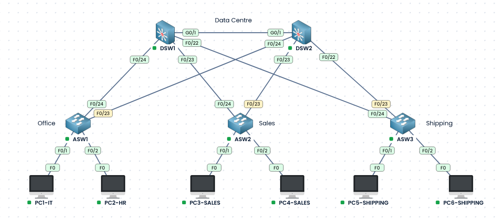

# CCNA Lab – Rapid PVST+ Spanning Tree

## Lab Overview

This lab was created using [PingMyNetwork Sandbox](https://www.pingmynetwork.com) to practise configuring, verifying, and troubleshooting Rapid Per-VLAN Spanning Tree Plus (Rapid PVST+) in a redundant switched network.

The topology consists of two distribution switches (DSW1 and DSW2), three access switches (ASW1, ASW2, and ASW3), and six PCs across four VLANs.

There are two .Json files available - the initial Spanningtree-Start.json file and the completed Spanningtree-Complete.json file both available in the config folder along with the completed switch configurations.

### Initial Configuration

- All switches are running standard PVST.
- Trunk links are configured between switches.
- VLANs 10, 20, 30, and 40 have been created.
- VTP has been enabled on all switches.
- PC-facing interfaces are configured as access ports with their respective VLAN assignments.
- Redundant uplinks connect the distribution and access switches.

## Lab Objectives

Complete the following objectives using the appropriate configuration and verification commands.

1. Enable Rapid PVST+ on all switches.
2. Configure root bridges.

   Configure DSW1 as primary root for VLANs 10 and 20, and secondary root for VLANs 30 and 40.

   Configure DSW2 as primary root for VLANs 30 and 40, and secondary root for VLANs 10 and 20.

   Verify the root bridge for each VLAN.

3. Identify root, designated, and alternate ports and verify their states.
4. Test redundant uplink failover and observe reconvergence.
5. Enable PortFast and BPDU Guard on PC-facing ports.

## Network Topology



## VLAN Configuration

| VLAN | Name | Network |
|------|------|---------|
| 10 | IT | 10.10.10.0/24 |
| 20 | HR | 10.20.20.0/24 |
| 30 | SALES | 10.30.30.0/24 |
| 40 | SHIPPING | 10.40.40.0/24 |

## Lab Walkthrough

(Only relevant sections of the show commands have been displayed, parts not relevant to the topic have been removed for space)

### Task 1 – Enable Rapid PVST+

Configure all five switches to use Rapid PVST+ and verify the operating mode.

run 'spanning-tree mode rapid-pvst' on each switch.

```
DSW1(config)# spanning-tree mode rapid-pvst
```

Verify spanning tree - run 'show spanning-tree' on each switch.

```
DSW2#show spanning-tree 
VLAN0001
  Spanning tree enabled protocol rstp
```

### Task 2 – Configure Root Bridges

Configure the primary and secondary root bridges. Verify the elected root bridge for each VLAN.

```
DSW1(config)#spanning-tree vlan 10 root primary
DSW1(config)#spanning-tree vlan 20 root primary
DSW1(config)#spanning-tree vlan 30 root secondary
DSW1(config)#spanning-tree vlan 40 root secondary
```

```
DSW2(config)#spanning-tree vlan 10 root secondary 
DSW2(config)#spanning-tree vlan 20 root secondary 
DSW2(config)#spanning-tree vlan 30 root primary 
DSW2(config)#spanning-tree vlan 40 root primary
```

Verify with show spanning-tree command. Notice on DSW1 priorities are set to the default 32768 for vlan 1 + 1 for the vlan, 24576 + 10 for vlan 10, 24576 + 20 for vlan 20, 28672 + 30 for vlan 30 and 28672 + 40 for vlan 40. The root bridge shows the output 'This bridge is the root'. 

```
DSW1#show spanning-tree 
VLAN0001
  Spanning tree enabled protocol rstp
  Root ID    Priority    32769
             Address     0070.8129.1758
             This bridge is the root
             Hello Time   2 sec  Max Age 20 sec  Forward Delay 15 sec

  Bridge ID  Priority    32769  (priority 32768 sys-id-ext 1)

VLAN0010
  Spanning tree enabled protocol rstp
  Root ID    Priority    24586
             Address     0070.8129.1758
             This bridge is the root
             Hello Time   2 sec  Max Age 20 sec  Forward Delay 15 sec

  Bridge ID  Priority    24586  (priority 24576 sys-id-ext 10)


VLAN0020
  Spanning tree enabled protocol rstp
  Root ID    Priority    24596
             Address     0070.8129.1758
             This bridge is the root
             Hello Time   2 sec  Max Age 20 sec  Forward Delay 15 sec

  Bridge ID  Priority    24596  (priority 24576 sys-id-ext 20)


VLAN0030
  Spanning tree enabled protocol rstp
  Root ID    Priority    24606
             Address     4007.0256.2516
             Cost        4
             Port        25 (GigabitEthernet0/1)
             Hello Time   2 sec  Max Age 20 sec  Forward Delay 15 sec

  Bridge ID  Priority    28702  (priority 28672 sys-id-ext 30)


VLAN0040
  Spanning tree enabled protocol rstp
  Root ID    Priority    24616
             Address     4007.0256.2516
             Cost        4
             Port        25 (GigabitEthernet0/1)
             Hello Time   2 sec  Max Age 20 sec  Forward Delay 15 sec

  Bridge ID  Priority    28712  (priority 28672 sys-id-ext 40)

```


```
DSW2#show spanning-tree 
VLAN0001
  Spanning tree enabled protocol rstp
  Root ID    Priority    32769
             Address     0070.8129.1758
             Cost        4
             Port        25 (GigabitEthernet0/1)
             Hello Time   2 sec  Max Age 20 sec  Forward Delay 15 sec

  Bridge ID  Priority    32769  (priority 32768 sys-id-ext 1)
             Address     4007.0256.2516
             Hello Time   2 sec  Max Age 20 sec  Forward Delay 15 sec
             Aging Time  300 sec

Interface           Role Sts Cost      Prio.Nbr Type
------------------- ---- --- --------- -------- --------------------------------
Fa0/22              Desg FWD 19        128.22   P2p
Fa0/23              Desg FWD 19        128.23   P2p
Fa0/24              Desg FWD 19        128.24   P2p
Gi0/1               Root FWD 4         128.25   P2p

VLAN0010
  Spanning tree enabled protocol rstp
  Root ID    Priority    24586
             Address     0070.8129.1758
             Cost        4
             Port        25 (GigabitEthernet0/1)
             Hello Time   2 sec  Max Age 20 sec  Forward Delay 15 sec

  Bridge ID  Priority    28682  (priority 28672 sys-id-ext 10)

VLAN0020
  Spanning tree enabled protocol rstp
  Root ID    Priority    24596
             Address     0070.8129.1758
             Cost        4
             Port        25 (GigabitEthernet0/1)
             Hello Time   2 sec  Max Age 20 sec  Forward Delay 15 sec

  Bridge ID  Priority    28692  (priority 28672 sys-id-ext 20)

VLAN0030
  Spanning tree enabled protocol rstp
  Root ID    Priority    24606
             Address     4007.0256.2516
             This bridge is the root
             Hello Time   2 sec  Max Age 20 sec  Forward Delay 15 sec

  Bridge ID  Priority    24606  (priority 24576 sys-id-ext 30)

VLAN0040
  Spanning tree enabled protocol rstp
  Root ID    Priority    24616
             Address     4007.0256.2516
             This bridge is the root
             Hello Time   2 sec  Max Age 20 sec  Forward Delay 15 sec

  Bridge ID  Priority    24616  (priority 24576 sys-id-ext 40)
```

### Task 3 – Identify STP Port Roles

Identify root, designated, and alternate ports for each VLAN. Notice their forwarding or discarding states.

Again, show spanning-tree displays the required information. States are displayed next to the port role. All ports on the root bridge are Designated Forwarding. 

```
DSW1#show spanning-tree
VLAN0010
             This bridge is the root


Interface           Role Sts Cost      Prio.Nbr Type
------------------- ---- --- --------- -------- --------------------------------
Fa0/22              Desg FWD 19        128.22   P2p
Fa0/23              Desg FWD 19        128.23   P2p
Fa0/24              Desg FWD 19        128.24   P2p
Gi0/1               Desg FWD 4         128.25   P2p

VLAN0020
             This bridge is the root

Interface           Role Sts Cost      Prio.Nbr Type
------------------- ---- --- --------- -------- --------------------------------
Fa0/22              Desg FWD 19        128.22   P2p
Fa0/23              Desg FWD 19        128.23   P2p
Fa0/24              Desg FWD 19        128.24   P2p
Gi0/1               Desg FWD 4         128.25   P2p

VLAN0030
  Root ID    Priority    24606
             Address     4007.0256.2516
             Cost        4
             Port        25 (GigabitEthernet0/1)

Interface           Role Sts Cost      Prio.Nbr Type
------------------- ---- --- --------- -------- --------------------------------
Fa0/22              Desg FWD 19        128.22   P2p
Fa0/23              Desg FWD 19        128.23   P2p
Fa0/24              Desg FWD 19        128.24   P2p
Gi0/1               Root FWD 4         128.25   P2p

VLAN0040
  Root ID    Priority    24616
             Address     4007.0256.2516
             Cost        4
             Port        25 (GigabitEthernet0/1)

Interface           Role Sts Cost      Prio.Nbr Type
------------------- ---- --- --------- -------- --------------------------------
Fa0/22              Desg FWD 19        128.22   P2p
Fa0/23              Desg FWD 19        128.23   P2p
Fa0/24              Desg FWD 19        128.24   P2p
Gi0/1               Root FWD 4         128.25   P2p
```

```
DSW2#show spanning-tree 
VLAN0010
  Root ID    Priority    24586
             Address     0070.8129.1758
             Cost        4
             Port        25 (GigabitEthernet0/1)

Interface           Role Sts Cost      Prio.Nbr Type
------------------- ---- --- --------- -------- --------------------------------
Fa0/22              Desg FWD 19        128.22   P2p
Fa0/23              Desg FWD 19        128.23   P2p
Fa0/24              Desg FWD 19        128.24   P2p
Gi0/1               Root FWD 4         128.25   P2p

VLAN0020
  Root ID    Priority    24596
             Address     0070.8129.1758
             Cost        4
             Port        25 (GigabitEthernet0/1)

Interface           Role Sts Cost      Prio.Nbr Type
------------------- ---- --- --------- -------- --------------------------------
Fa0/22              Desg FWD 19        128.22   P2p
Fa0/23              Desg FWD 19        128.23   P2p
Fa0/24              Desg FWD 19        128.24   P2p
Gi0/1               Root FWD 4         128.25   P2p

VLAN0030
             This bridge is the root

Interface           Role Sts Cost      Prio.Nbr Type
------------------- ---- --- --------- -------- --------------------------------
Fa0/22              Desg FWD 19        128.22   P2p
Fa0/23              Desg FWD 19        128.23   P2p
Fa0/24              Desg FWD 19        128.24   P2p
Gi0/1               Desg FWD 4         128.25   P2p

VLAN0040
             This bridge is the root

Interface           Role Sts Cost      Prio.Nbr Type
------------------- ---- --- --------- -------- --------------------------------
Fa0/22              Desg FWD 19        128.22   P2p
Fa0/23              Desg FWD 19        128.23   P2p
Fa0/24              Desg FWD 19        128.24   P2p
Gi0/1               Desg FWD 4         128.25   P2p
```

On the access switches, the PC-facing ports are marked as Designated Edge ports. There is also one Forwarding Root port and one Alternate port in a Blocking state for each vlan.

```
ASW1#show spanning-tree
VLAN0010
  Spanning tree enabled protocol rstp
  Root ID    Priority    24586
             Address     0070.8129.1758
             Cost        19
             Port        24 (FastEthernet0/24)

Interface           Role Sts Cost      Prio.Nbr Type
------------------- ---- --- --------- -------- --------------------------------
Fa0/1               Desg FWD 19        128.1    P2p Edge
Fa0/23              Altn BLK 19        128.23   P2p
Fa0/24              Root FWD 19        128.24   P2p

VLAN0020
  Spanning tree enabled protocol rstp
  Root ID    Priority    24596
             Address     0070.8129.1758
             Cost        19
             Port        24 (FastEthernet0/24)

Interface           Role Sts Cost      Prio.Nbr Type
------------------- ---- --- --------- -------- --------------------------------
Fa0/2               Desg FWD 19        128.2    P2p Edge
Fa0/23              Altn BLK 19        128.23   P2p
Fa0/24              Root FWD 19        128.24   P2p

VLAN0030
  Spanning tree enabled protocol rstp
  Root ID    Priority    24606
             Address     4007.0256.2516
             Cost        19
             Port        23 (FastEthernet0/23)

Interface           Role Sts Cost      Prio.Nbr Type
------------------- ---- --- --------- -------- --------------------------------
Fa0/23              Root FWD 19        128.23   P2p
Fa0/24              Altn BLK 19        128.24   P2p

VLAN0040
  Spanning tree enabled protocol rstp
  Root ID    Priority    24616
             Address     4007.0256.2516
             Cost        19
             Port        23 (FastEthernet0/23)

Interface           Role Sts Cost      Prio.Nbr Type
------------------- ---- --- --------- -------- --------------------------------
Fa0/23              Root FWD 19        128.23   P2p
Fa0/24              Altn BLK 19        128.24   P2p
```

### Task 4 – Test Redundant Uplink Failover

Shut down an active uplink, observe reconvergence, verify the alternative path, and restore the original connection.

For this one, Fa0/24 to DSW1 will be shut down

Pre shutdown:

```
ASW2#show spanning-tree vlan 10
VLAN0010
  Spanning tree enabled protocol rstp
  Root ID    Priority    24586
             Address     0070.8129.1758
             Cost        19
             Port        24 (FastEthernet0/24)
             Hello Time   2 sec  Max Age 20 sec  Forward Delay 15 sec

  Bridge ID  Priority    32778  (priority 32768 sys-id-ext 10)
             Address     5690.7236.3577
             Hello Time   2 sec  Max Age 20 sec  Forward Delay 15 sec
             Aging Time  300 sec

Interface           Role Sts Cost      Prio.Nbr Type
------------------- ---- --- --------- -------- --------------------------------
Fa0/23              Altn BLK 19        128.23   P2p
Fa0/24              Root FWD 19        128.24   P2p
```

Post shutdown, notice fa0/23 has now transitioned to a forwarding state for vlan 10.

```
ASW2(config)#int fa0/24
ASW2(config-if)#shut
ASW2(config-if)#end
*Oct 15 21:47:18.575: %SYS-5-CONFIG_I: Configured from console by console
ASW2#
*Oct 15 21:47:18.892: %LINK-5-CHANGED: Interface FastEthernet0/24, changed state to administratively down
ASW2#
*Oct 15 21:47:19.892: %LINEPROTO-5-UPDOWN: Line protocol on Interface FastEthernet0/24, changed state to down
ASW2#show spanning-tree vlan 10
VLAN0010
  Spanning tree enabled protocol rstp
  Root ID    Priority    24586
             Address     0070.8129.1758
             Cost        23
             Port        23 (FastEthernet0/23)
             Hello Time   2 sec  Max Age 20 sec  Forward Delay 15 sec

  Bridge ID  Priority    32778  (priority 32768 sys-id-ext 10)
             Address     5690.7236.3577
             Hello Time   2 sec  Max Age 20 sec  Forward Delay 15 sec
             Aging Time  300 sec

Interface           Role Sts Cost      Prio.Nbr Type
------------------- ---- --- --------- -------- --------------------------------
Fa0/23              Root FWD 19        128.23   P2p
```

Re-enabling the port allows fa0/24 to become the root port to the root switch again.

```
ASW2(config)#int fa0/24
ASW2(config-if)#no shut
ASW2(config-if)#end
*Oct 15 21:48:36.956: %SYS-5-CONFIG_I: Configured from console by console
*Oct 15 21:48:38.254: %LINK-3-UPDOWN: Interface FastEthernet0/24, changed state to up
*Oct 15 21:48:39.254: %LINEPROTO-5-UPDOWN: Line protocol on Interface FastEthernet0/24, changed state to up
ASW2#show spanning-tree vlan 10
VLAN0010
  Spanning tree enabled protocol rstp
  Root ID    Priority    24586
             Address     0070.8129.1758
             Cost        19
             Port        24 (FastEthernet0/24)
             Hello Time   2 sec  Max Age 20 sec  Forward Delay 15 sec

  Bridge ID  Priority    32778  (priority 32768 sys-id-ext 10)
             Address     5690.7236.3577
             Hello Time   2 sec  Max Age 20 sec  Forward Delay 15 sec
             Aging Time  300 sec

Interface           Role Sts Cost      Prio.Nbr Type
------------------- ---- --- --------- -------- --------------------------------
Fa0/23              Altn BLK 19        128.23   P2p
Fa0/24              Root FWD 19        128.24   P2p
```

What if the root switch goes offline? DSW2 takes over as the root for all vlans and blocked links to the new root bridge transition to a forwarding state.

```
DSW2#show spanning-tree vlan 10
VLAN0010
  Spanning tree enabled protocol rstp
  Root ID    Priority    28682
             Address     4007.0256.2516
             This bridge is the root
             Hello Time   2 sec  Max Age 20 sec  Forward Delay 15 sec

  Bridge ID  Priority    28682  (priority 28672 sys-id-ext 10)
             Address     4007.0256.2516
             Hello Time   2 sec  Max Age 20 sec  Forward Delay 15 sec
             Aging Time  300 sec

Interface           Role Sts Cost      Prio.Nbr Type
------------------- ---- --- --------- -------- --------------------------------
Fa0/22              Desg FWD 19        128.22   P2p
Fa0/23              Desg FWD 19        128.23   P2p
Fa0/24              Desg FWD 19        128.24   P2p
```

```
ASW2#show spanning-tree vlan 10
VLAN0010
  Spanning tree enabled protocol rstp
  Root ID    Priority    28682
             Address     4007.0256.2516
             Cost        19
             Port        23 (FastEthernet0/23)
             Hello Time   2 sec  Max Age 20 sec  Forward Delay 15 sec

  Bridge ID  Priority    32778  (priority 32768 sys-id-ext 10)
             Address     5690.7236.3577
             Hello Time   2 sec  Max Age 20 sec  Forward Delay 15 sec
             Aging Time  300 sec

Interface           Role Sts Cost      Prio.Nbr Type
------------------- ---- --- --------- -------- --------------------------------
Fa0/23              Root FWD 19        128.23   P2p
```


### Task 5 – Configure PortFast and BPDU Guard

Configure both features on PC-facing ports. Test their protection behaviour and verify interface status. 'Spanning-tree portfast' enables portfast on the access ports. This can be verified by looking at the interface detail. It will display 'The port is in the portfast mode'. Portfast skips the learning state and immediately starts forwarding. 


```
ASW1(config)#int range fa0/1-2
ASW1(config-if-range)#spanning-tree portfast 
%Warning: portfast should only be enabled on ports connected to a single
 host. Connecting hubs, concentrators, switches, bridges, etc... to this
 interface  when portfast is enabled, can cause temporary bridging loops.
 Use with CAUTION

%Portfast will be configured in 2 interfaces due to the range command
 but will only have effect when the interfaces are in a non-trunking mode.
 ```

```
ASW1#show spanning-tree interface fa0/1 detail
 Port 1 (FastEthernet0/1) of VLAN0010 is designated forwarding 
   Port path cost 19, Port priority 128, Port Identifier 128.1.
   Designated root has priority 24586, address 0070.8129.1758
   Designated bridge has priority 32778, address 1613.8850.9303
   Designated port id is 128.1, designated path cost 19
   Timers: message age 0, forward delay 0, hold 0
   Number of transitions to forwarding state: 2
   The port is in the portfast mode
   Link type is point-to-point by default
   BPDU: sent 2428, received 0
```

```
ASW1#show run | section interface FastEthernet0/1
interface FastEthernet0/1
 switchport access vlan 10
 switchport mode access
 spanning-tree portfast
```

And if a switch is connected to the port and receives a BPDU? The port will lose its portfast state and remain enabled.

```*Oct 15 22:01:45.207: %LINEPROTO-5-UPDOWN: Line protocol on Interface FastEthernet0/1, changed state to down
*Oct 15 22:01:46.207: %LINK-3-UPDOWN: Interface FastEthernet0/1, changed state to down
*Oct 15 22:01:47.214: %LINK-3-UPDOWN: Interface FastEthernet0/1, changed state to up
*Oct 15 22:01:48.214: %LINEPROTO-5-UPDOWN: Line protocol on Interface FastEthernet0/1, changed state to up
ASW1#show spanning-tree interface fa0/1 detail
 Port 1 (FastEthernet0/1) of VLAN0010 is designated forwarding 
   Port path cost 19, Port priority 128, Port Identifier 128.1.
   Designated root has priority 24586, address 0070.8129.1758
   Designated bridge has priority 32778, address 1613.8850.9303
   Designated port id is 128.1, designated path cost 19
   Timers: message age 0, forward delay 0, hold 0
   Number of transitions to forwarding state: 2
   Link type is point-to-point by default
   BPDU: sent 44, received 3
```

Now enabling BPDU guard. The same commands can be used to check BPDU guard is active.

```
ASW1(config)#int range fa0/1-2
ASW1(config-if-range)#spanning-tree bpduguard enable 
```

```
ASW1#show spanning-tree interface fa0/1 detail
 Port 1 (FastEthernet0/1) of VLAN0010 is designated forwarding 
   Port path cost 19, Port priority 128, Port Identifier 128.1.
   Designated root has priority 24586, address 0070.8129.1758
   Designated bridge has priority 32778, address 1613.8850.9303
   Designated port id is 128.1, designated path cost 19
   Timers: message age 0, forward delay 0, hold 0
   Number of transitions to forwarding state: 1
   The port is in the portfast mode
   Link type is point-to-point by default
   Bpdu guard is enabled
   BPDU: sent 56, received 0
```

```
ASW1#show run | section interface FastEthernet0/1
interface FastEthernet0/1
 switchport access vlan 10
 switchport mode access
 spanning-tree portfast
 spanning-tree bpduguard enable
```

Once a switch is connected to the port, this time it will shutdown with an err-disable state

```
*Oct 15 22:07:42.819: %LINEPROTO-5-UPDOWN: Line protocol on Interface FastEthernet0/1, changed state to down
*Oct 15 22:07:43.819: %LINK-3-UPDOWN: Interface FastEthernet0/1, changed state to down
*Oct 15 22:07:44.828: %LINK-3-UPDOWN: Interface FastEthernet0/1, changed state to up
*Oct 15 22:07:44.854: %SPANTREE-2-BLOCK_BPDUGUARD: Received BPDU on port Fa0/1 with BPDU Guard enabled. Disabling port.
*Oct 15 22:07:44.854: %PM-4-ERR_DISABLE: bpduguard error detected on Fa0/1, putting Fa0/1 in err-disable state
*Oct 15 22:07:46.854: %LINK-3-UPDOWN: Interface FastEthernet0/1, changed state to down
```

```
ASW1#show ip int br
Interface              IP-Address      OK? Method Status                Protocol
FastEthernet0/1        unassigned      YES unset  down                  down
```

```
ASW1#show int fa0/1
FastEthernet0/1 is down, line protocol is down (err-disabled) 
```

Trying to re-enable the port without removing the switch causes it to go back into err-disable state. Remove the switch then shut/no shut the port to bring it back online.

```
ASW1(config)#int fa0/1
ASW1(config-if)#shutdown 
ASW1(config-if)#no shutdown 
*Oct 15 22:10:46.180: %LINK-3-UPDOWN: Interface FastEthernet0/1, changed state to up
*Oct 15 22:10:46.206: %SPANTREE-2-BLOCK_BPDUGUARD: Received BPDU on port Fa0/1 with BPDU Guard enabled. Disabling port.
*Oct 15 22:10:46.206: %PM-4-ERR_DISABLE: bpduguard error detected on Fa0/1, putting Fa0/1 in err-disable state
*Oct 15 22:10:48.206: %LINK-3-UPDOWN: Interface FastEthernet0/1, changed state to down
```

```
ASW1(config-if)#no shut
*Oct 15 22:12:13.642: %LINK-3-UPDOWN: Interface FastEthernet0/1, changed state to up
*Oct 15 22:12:14.642: %LINEPROTO-5-UPDOWN: Line protocol on Interface FastEthernet0/1, changed state to up
ASW1(config-if)#end
*Oct 15 22:12:25.374: %SYS-5-CONFIG_I: Configured from console by console
```
