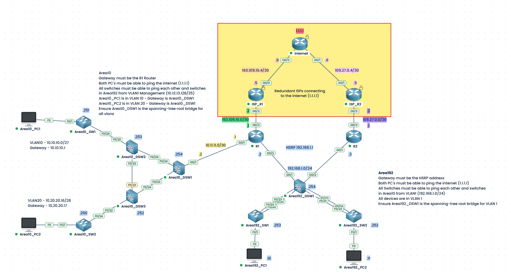

# CCNA Troubleshooting Lab — Dual-Campus Network

**Topics:** VLANs · 802.1Q trunks · Rapid PVST+ · EtherChannel (LACP) · DTP · Inter-VLAN routing · OSPF · HSRP · Static routing · IP addressing

This hands-on troubleshooting challenge has been created using the [PingMyNetwork Sandbox](https://www.pingmynetwork.com/) and takes place in a preconfigured network containing two campus areas, **Area10** and **Area192**, connected to a simulated internet through two edge routers. The starter lab contains deliberately introduced configuration errors. Your task is to diagnose and repair the **internal network** until it meets all the requirements below.

**Do not reconfigure the ISP infrastructure in the yellow area of the topology.** The `Internet`, `ISP_R1` and `ISP_R2` devices are outside the troubleshooting scope.

## Lab files

| File | Description |
|---|---|
| [`Troubleshoot-Start.json`](Troubleshoot-Start.json) | **Start here.** The intentionally faulty sandbox network. |
| [`Troubleshoot-Complete.json`](Troubleshoot-Complete.json) | Reference network with the intended working configuration. **Avoid opening until you have attempted the challenge.** |
| [`topology.png`](topology.png) | Network diagram, addresses and design requirements. |

Open [PingMyNetwork Sandbox](https://www.pingmynetwork.com/) and import `Troubleshoot-Start.json`.

The configs folder also contains all completed switch and router configs. **Avoid opening until you have attempted the challenge.**

## Network topology



The simulated internet destination is **`1.1.1.1`**. The two customer-edge routers connect to separate ISP routers; R1 also provides Area10's upstream routed connection, while R1 and R2 jointly provide Area192's HSRP default gateway.

## Intended addressing

### Area10 — VLANs and routed uplink

| Network / device | Address or subnet | Intended purpose |
|---|---|---|
| VLAN 10 | `10.10.10.0/27` | Area10_PC1 user VLAN |
| VLAN 10 gateway (Area10_DSW1) | `10.10.10.1/27` | Inter-VLAN routing |
| Area10_PC1 | `10.10.10.2/27` | Default gateway `10.10.10.1` |
| VLAN 20 | `10.20.20.16/28` | Area10_PC2 user VLAN |
| VLAN 20 gateway (Area10_DSW1) | `10.20.20.17/28` | Inter-VLAN routing |
| Area10_PC2 | `10.20.20.18/28` | Default gateway `10.20.20.17` |
| Management VLAN 1 | `10.12.13.128/25` | Management for Area10 switches |
| Area10_DSW1 / DSW2 / DSW3 | `10.12.13.254` / `.253` / `.252` | VLAN 1 management IPs |
| Area10_SW1 / SW2 | `10.12.13.251` / `.250` | VLAN 1 management IPs |
| R1–Area10_DSW1 transit | `10.11.11.0/30` | R1 `10.11.11.1`, DSW1 `10.11.11.2` |

The Area10 access switches and intermediate distribution switches should carry the necessary VLANs to **Area10_DSW1**, which is the Layer 3 gateway for VLANs 10 and 20. Area10's route towards the wider network and simulated internet is through **R1**. Switch management traffic must also reach remote networks.

### Area192 — HSRP and Layer 2 switching

| Network / device | Address or subnet | Intended purpose |
|---|---|---|
| Area192 LAN / VLAN 1 | `192.168.1.0/24` | Hosts and switch management |
| HSRP virtual gateway | `192.168.1.1` | Default gateway for Area192 |
| R1 / R2 LAN interfaces | `192.168.1.2` / `192.168.1.3` | HSRP group members |
| Area192_DSW1 | `192.168.1.254` | Distribution-switch management |
| Area192_SW1 / SW2 | `192.168.1.253` / `.252` | Access-switch management |
| Area192_PC1 / PC2 | `192.168.1.10` / `192.168.1.11` | Default gateway `192.168.1.1` |

Area192 uses **VLAN 1** and has two LACP EtherChannel uplinks between `Area192_DSW1` and the access switches. The link bundles must provide the expected Layer 2 connectivity and trunk operation. The HSRP virtual IP must remain the hosts' gateway during a router failover.

## Your objectives

Repair the internal network until all of these conditions are satisfied:

1. **Area10 host addressing:** Both Area10 PCs have the correct IP address, subnet mask and default gateway, and each is connected to its intended VLAN.
2. **Inter-VLAN routing:** Area10_PC1 (VLAN 10) and Area10_PC2 (VLAN 20) can communicate through Area10_DSW1.
3. **Area10 upstream routing:** Area10 can reach R1, Area192 and `1.1.1.1`. Internal routing information is exchanged as intended.
4. **Area10 management:** All five Area10 switches can reach each other and the management interfaces in Area192 using their VLAN 1 addresses.
5. **Area10 spanning tree:** `Area10_DSW1` is the Rapid PVST+ root bridge for **VLANs 1, 10 and 20**. Required links forward correctly and the Layer 2 topology is loop-free.
6. **Area192 gateway:** All Area192 clients and switches use the HSRP virtual IP `192.168.1.1` as their default gateway.
7. **Area192 EtherChannels:** Both access-switch uplinks form operational LACP bundles and carry the required VLAN traffic as trunks.
8. **Area192 spanning tree:** `Area192_DSW1` is the Rapid PVST+ root bridge for **VLAN 1**.
9. **End-to-end reachability:** Both Area192 PCs can ping `1.1.1.1`, and the Area10 and Area192 switches can reach one another's management addresses.
10. **Preserve the ISP network:** Do not modify `Internet`, `ISP_R1`, or `ISP_R2` or their routing configuration.

**Troubleshooting note:** There may be multiple independent faults, and one fault can conceal another. A successful ping to a single destination does not prove that the full network is repaired.

## Recommended troubleshooting workflow

Start at the endpoints and work towards the Layer 3 gateways. For each failure, record the symptom, the relevant command output, the change you made, and the result after retesting.

### Host and VLAN checks

```text
ipconfig
ping <default-gateway>
```

```cisco
show ip interface brief
show vlan brief
show interfaces trunk
show interfaces switchport
```

### Spanning tree and EtherChannel

```cisco
show spanning-tree vlan 1
show spanning-tree vlan 10
show spanning-tree vlan 20
show etherchannel summary
show lacp neighbor
show interfaces trunk
```

### Routing and redundancy

```cisco
show ip route
show ip ospf neighbor
show ip ospf interface brief
show standby brief
show standby
show track
```

Use the commands appropriate to the device and the symptom.

## Verification checklist

- [ ] Area10_PC1 can ping `10.10.10.1`.
- [ ] Area10_PC2 can ping `10.20.20.17`.
- [ ] Area10_PC1 and Area10_PC2 can ping each other.
- [ ] Both Area10 PCs can ping `192.168.1.1` and `1.1.1.1`.
- [ ] All Area10 switches can reach the management interfaces of the other Area10 switches.
- [ ] Area10 management switches can reach Area192 management IPs, and vice versa.
- [ ] Area10_DSW1 is STP root for VLANs 1, 10 and 20.
- [ ] Area192_PC1 and Area192_PC2 can ping `192.168.1.1` and `1.1.1.1`.
- [ ] Area192_DSW1, SW1 and SW2 have working management reachability.
- [ ] Both Area192 LACP EtherChannels are operational, and their required trunks are forwarding.
- [ ] Area192_DSW1 is STP root for VLAN 1.
- [ ] HSRP has the correct active/standby roles and the virtual gateway responds.
- [ ] All ISP-side devices remain unchanged.

## Completion

You have finished when the network meets **all** of the objectives and the verification checklist, without modifying the ISP-side devices. When you are finished, compare your work with [`Troubleshoot-Complete.json`](Troubleshoot-Complete.json) to review the intended end state.

This lab is designed for **Cisco CCNA troubleshooting practice**, combining switching, addressing, routing and first-hop redundancy in a multi-fault environment.
